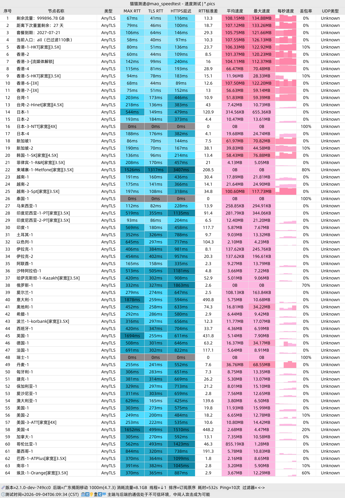
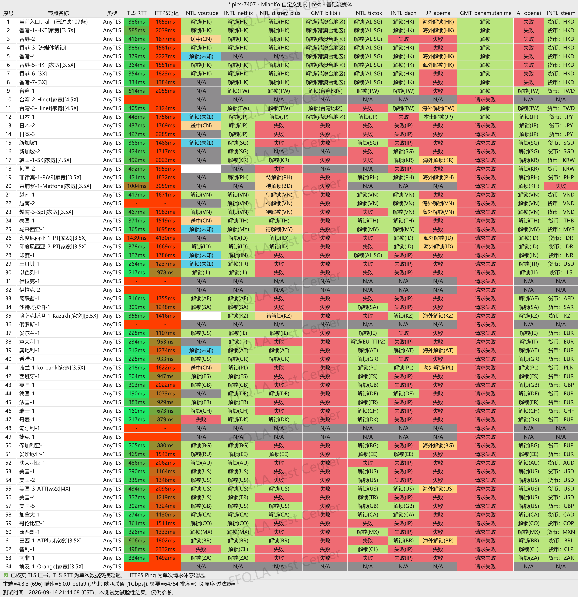
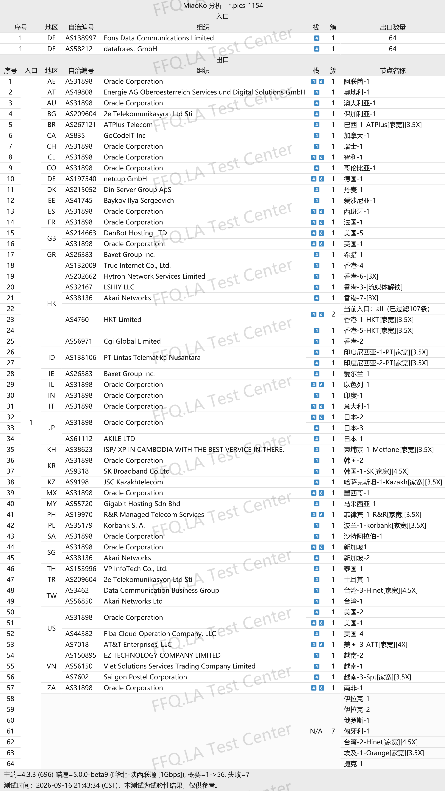

🇨🇳 [中文](README.md) | 🇺🇸 English | 🇷🇺 [Русский](README_RU.md) | 🇮🇷 [فارسی](README_FA.md)

# StepFly VPN Official Website (Updated November 3, 2026)

StepFly VPN Official Website<br>
Official Address: [stepfly.space](https://to.iix.im/sf01)<br>

Latest Recommended VPN Services and Node Sharing for 2026: [https://github.com/jdnei/JiChangTuiJian](https://github.com/jdnei/JiChangTuiJian)<br>

## Telegram VPN Deals & Benefits Community #AD

[VPN Giveaway Group](https://331024.de/archives/choujiang) | [VPN Chat Group](https://331024.de/archives/choujiang) | [VPN Trial Group](https://331024.de/archives/choujiang)<br>

[https://331024.de/archives/choujiang](https://331024.de/archives/choujiang)

## Invitation Code

```bash
5tZMbsC1
```

## Promo Code / Discount Code

`40% off, promotion ends on October 3`

```bash
stepfly44
```

## Overview

StepFly VPN is an affordable relay-based VPN service offering servers in multiple regions.

The service supports modern protocols such as VLESS and AnyTLS and is compatible with popular clients, including Shadowrocket, Clash, Sing-box, and V2rayN.

According to its website, StepFly offers connections in Hong Kong, Japan, the United States, and other regions, along with subscription plans featuring different data allowances.

## Advantages

StepFly VPN provides servers across multiple regions worldwide.

It uses Cloudflare/CDN infrastructure and aggregated relay connections to optimize connectivity for China's three major network operators.

The service supports one-click subscription imports through popular VPN clients and provides access to streaming platforms with regional restrictions.

With generous data allowances and affordable entry-level prices, StepFly is suitable for everyday browsing, downloading, and multi-device usage.

Its extensive server selection makes it particularly attractive to users seeking good value for money.

StepFly also offers **residential broadband connections in multiple countries**, **residential proxies in various regions**, and **AI-friendly network routes**.

## Plans & Pricing

| Plan | Price | Billing Period | Data Allowance | Speed | Devices | Recommended Users | Network Infrastructure | Server Locations | Additional Features | Refund Policy |
|---|---:|---|---:|---:|---:|---|---|---|---|---|
| Small Plan | **¥5.88/month** | Monthly / Quarterly / Semiannual / Annual | **1TB/month** | **2 Gbps** | **5 devices** | Suitable for users with limited international internet needs, personal study, and light usage | Cloudflare + aggregated forwarding, optimized for China's three major network operators | Popular global locations | Streaming platform unblocking | No refunds; do not purchase if you disagree with this policy |
| Medium Plan | **¥11.99/month** | Monthly / Semiannual / Annual | **5000GB/month (approximately 4.9TB)** | **2 Gbps** | **5 devices** | Suitable for moderate international internet needs, personal study, and regular usage | Cloudflare + aggregated forwarding, optimized for China's three major network operators | Popular global locations | Streaming platform unblocking | No refunds; do not purchase if you disagree with this policy |
| Large Plan | **¥35/month** | Monthly / Semiannual / Annual | **20000GB/month (approximately 19.5TB)** | **2 Gbps** | **5 devices** | Suitable for extensive international internet needs, personal study, and heavy usage | Cloudflare + aggregated forwarding, optimized for China's three major network operators | Popular global locations | Streaming platform unblocking | No refunds; do not purchase if you disagree with this policy |
| Mini Plan | **¥2.88/month** | Monthly | **88GB/month** | **500 Mbps** | **2 devices** | **Primarily suitable for China Telecom users**; designed for light usage and limited international internet needs | Cloudflare relay only, without aggregated entry points; selected residential broadband exit nodes | Popular global locations | Streaming platform unblocking | No refunds; some users may need to change their system DNS settings |
| Custom Node Plan | **¥999/year** | Annual | **Approximately 9.8TB** | **5 Gbps** | **999 devices** | Supports customized data center or residential broadband nodes in specified countries or regions; private dedicated and shared public nodes are available; submit a support ticket to discuss specific requirements | Customized according to business requirements | Customizable countries and regions | Private dedicated nodes or shared public nodes | Subject to the terms of the customized service |

## 📊 Real-World Performance Tests & Analysis

#### 1. Evening Peak-Hour Speed Test Results

<br>

#### 2. Streaming Service Unblocking Report

<br>

#### 3. Exit Node and Network Entry Analysis

<br>
