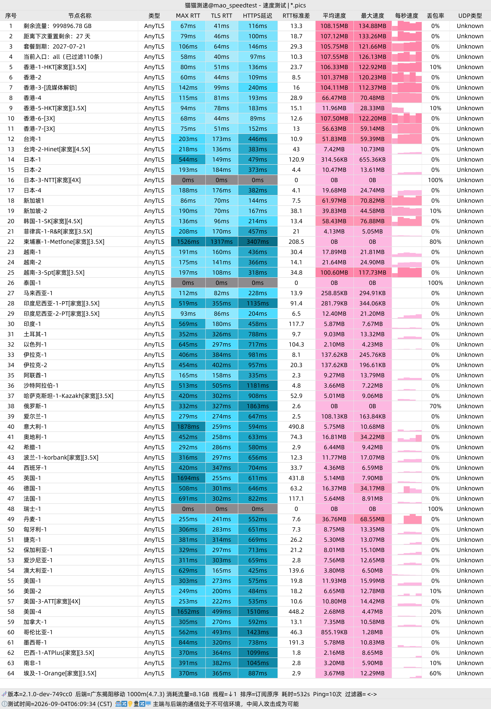
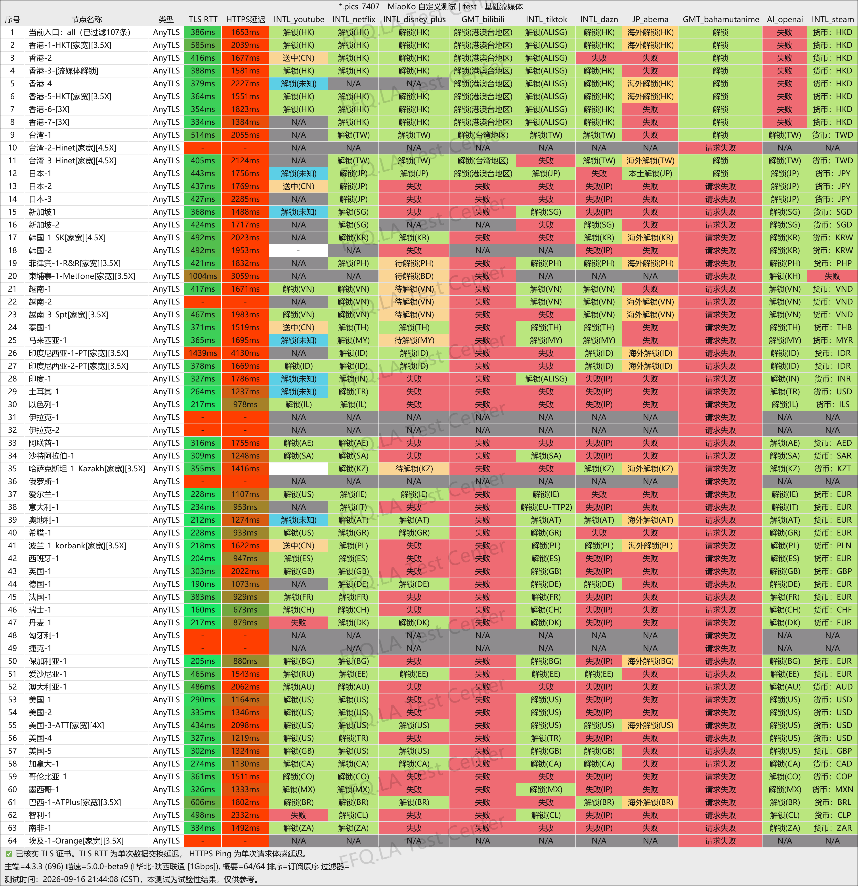
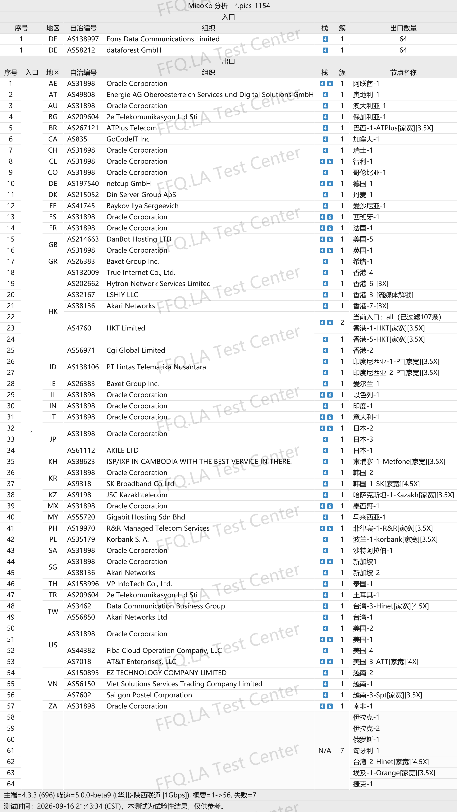

 🇨🇳 [中文](README.md) | 🇺🇸 [English](README_EN.md) | 🇷🇺 [Русский](README_RU.md) | 🇮🇷 فارسی
# آدرس رسمی VPN استپ‌فلای (StepFly) -(به‌روزرسانی 6 نوامبر 2026)
وب‌سایت رسمی VPN استپ‌فلای (StepFly)<br>
آدرس رسمی: [stepfly.space](https://to.iix.im/sf01)<br>

معرفی بهترین سرویس‌های VPN و اشتراک‌گذاری سرورها در سال ۲۰۲۶: [https://github.com/jdnei/JiChangTuiJian](https://github.com/jdnei/JiChangTuiJian)<br>

## انجمن تلگرامی تخفیف‌ها و مزایای VPN #AD

[گروه قرعه‌کشی VPN](https://331024.de/archives/choujiang) | [گروه گفت‌وگوی VPN](https://331024.de/archives/choujiang) | [گروه آزمایش رایگان VPN](https://331024.de/archives/choujiang)<br>

[https://331024.de/archives/choujiang](https://331024.de/archives/choujiang)

## کد دعوت

```bash
5tZMbsC1
```

## کد تخفیف

`۴۰٪ تخفیف، پایان جشنواره: ۳ اکتبر`

```bash
stepfly44
```

## معرفی

StepFly VPN یک سرویس VPN اقتصادی مبتنی بر سرورهای واسطه است که سرورهایی در مناطق مختلف جهان ارائه می‌دهد.

این سرویس از پروتکل‌های جدیدی مانند VLESS و AnyTLS پشتیبانی می‌کند و با کلاینت‌های رایج از جمله Shadowrocket، Clash، Sing-box و V2rayN سازگار است.

طبق اطلاعات وب‌سایت رسمی، StepFly مسیرهایی در هنگ‌کنگ، ژاپن، ایالات متحده و مناطق دیگر ارائه می‌دهد و دارای طرح‌های اشتراک متنوع با حجم‌های مختلف اینترنت است.

## مزایا

StepFly VPN سرورهایی در مناطق مختلف جهان ارائه می‌دهد.

این سرویس از زیرساخت Cloudflare/CDN و اتصالات واسطه تجمیع‌شده برای بهینه‌سازی ارتباط کاربران سه اپراتور اصلی شبکه چین استفاده می‌کند.

StepFly از واردکردن اشتراک با یک کلیک در کلاینت‌های رایج VPN پشتیبانی می‌کند و امکان دسترسی به سرویس‌های پخش آنلاین دارای محدودیت جغرافیایی را فراهم می‌سازد.

حجم بالای ترافیک و قیمت اولیه اقتصادی، این سرویس را برای وب‌گردی روزمره، دانلود فایل و استفاده از چندین دستگاه مناسب می‌کند.

تنوع زیاد سرورها نیز برای کاربرانی که به دنبال نسبت مناسب قیمت به امکانات هستند، جذاب است.

StepFly همچنین **اتصالات اینترنت خانگی در کشورهای مختلف**، **پروکسی‌های مسکونی در مناطق گوناگون** و **مسیرهای سازگار با سرویس‌های هوش مصنوعی** ارائه می‌دهد.

## طرح‌ها و قیمت‌ها

| نام طرح | قیمت | دوره پرداخت | حجم ترافیک | سرعت | تعداد دستگاه | کاربران مناسب | زیرساخت شبکه | مناطق سرورها | امکانات اضافی | سیاست بازپرداخت |
|---|---:|---|---:|---:|---:|---|---|---|---|---|
| طرح کوچک | **¥5.88/ماه** | ماهانه / سه‌ماهه / شش‌ماهه / سالانه | **1TB/ماه** | **2 Gbps** | **۵ دستگاه** | مناسب کاربرانی با نیاز محدود به اینترنت بین‌المللی، مطالعه شخصی و استفاده سبک | Cloudflare + انتقال تجمیع‌شده؛ بهینه‌سازی برای سه اپراتور اصلی چین | سرورهای محبوب در سراسر جهان | رفع محدودیت سرویس‌های پخش آنلاین | بدون بازپرداخت؛ در صورت نپذیرفتن این شرایط، خرید نکنید |
| طرح متوسط | **¥11.99/ماه** | ماهانه / شش‌ماهه / سالانه | **5000GB/ماه (تقریباً 4.9TB)** | **2 Gbps** | **۵ دستگاه** | مناسب نیاز متوسط به اینترنت بین‌المللی، مطالعه شخصی و استفاده معمول | Cloudflare + انتقال تجمیع‌شده؛ بهینه‌سازی برای سه اپراتور اصلی چین | سرورهای محبوب در سراسر جهان | رفع محدودیت سرویس‌های پخش آنلاین | بدون بازپرداخت؛ در صورت نپذیرفتن این شرایط، خرید نکنید |
| طرح بزرگ | **¥35/ماه** | ماهانه / شش‌ماهه / سالانه | **20000GB/ماه (تقریباً 19.5TB)** | **2 Gbps** | **۵ دستگاه** | مناسب نیاز زیاد به اینترنت بین‌المللی، مطالعه شخصی و استفاده سنگین | Cloudflare + انتقال تجمیع‌شده؛ بهینه‌سازی برای سه اپراتور اصلی چین | سرورهای محبوب در سراسر جهان | رفع محدودیت سرویس‌های پخش آنلاین | بدون بازپرداخت؛ در صورت نپذیرفتن این شرایط، خرید نکنید |
| طرح مینی | **¥2.88/ماه** | ماهانه | **88GB/ماه** | **500 Mbps** | **۲ دستگاه** | **عمدتاً مناسب کاربران China Telecom**؛ برای استفاده سبک و نیاز محدود به اینترنت بین‌المللی | فقط مسیر واسطه Cloudflare، بدون نقاط ورودی تجمیع‌شده؛ استفاده از سرورهای خروجی منتخب با اینترنت خانگی | سرورهای محبوب در سراسر جهان | رفع محدودیت سرویس‌های پخش آنلاین | بدون بازپرداخت؛ بعضی کاربران ممکن است نیاز به تغییر تنظیمات DNS سیستم داشته باشند |
| طرح سرور سفارشی | **¥999/سال** | سالانه | **تقریباً 9.8TB** | **5 Gbps** | **۹۹۹ دستگاه** | امکان سفارش سرورهای مرکز داده یا اینترنت خانگی در کشورها و مناطق مشخص؛ ارائه سرورهای خصوصی اختصاصی یا عمومی اشتراکی؛ برای هماهنگی شرایط می‌توان تیکت ثبت کرد | سفارشی‌سازی بر اساس نیاز کسب‌وکار | امکان انتخاب کشور یا منطقه دلخواه | انتخاب میان سرورهای خصوصی اختصاصی و عمومی اشتراکی | مطابق شرایط خدمات سفارشی |

## 📊 آزمایش‌های عملی عملکرد و تحلیل نتایج

#### ۱. نتایج آزمایش سرعت در ساعات اوج مصرف شبانه

<br>

#### ۲. گزارش رفع محدودیت سرویس‌های پخش آنلاین

<br>

#### ۳. تحلیل سرورهای خروجی و مسیرهای ورودی شبکه

<br>
