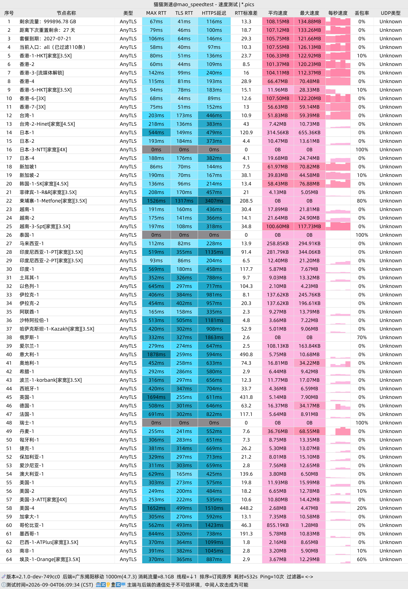
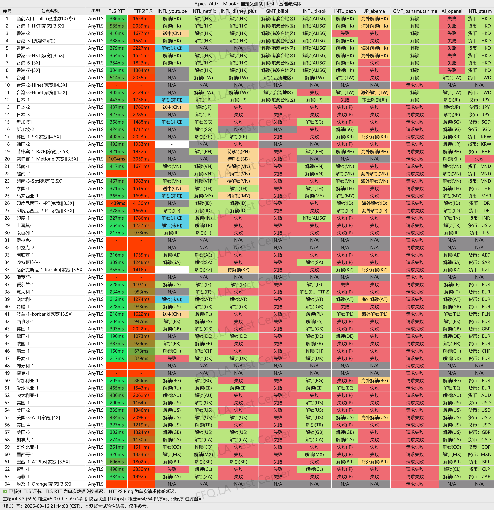
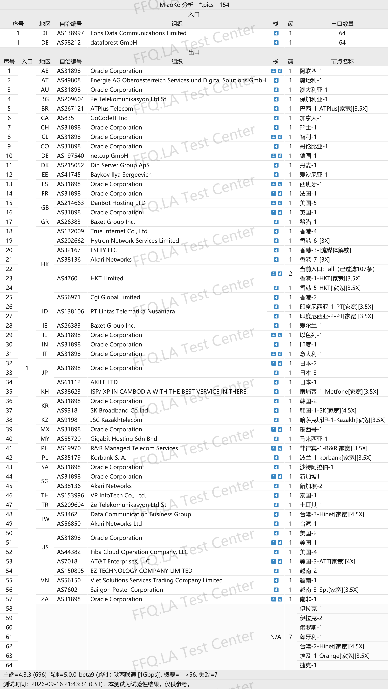

🇨🇳 [中文](README.md) | 🇺🇸 [English](README_EN.md) | 🇷🇺 Русский | 🇮🇷 [فارسی](README_FA.md)

# Официальный сайт StepFly VPN (обновлено 9 ноября 2026)

Официальный сайт VPN-сервиса StepFly<br>
Официальный адрес: [stepfly.space](https://to.iix.im/sf01)<br>

Лучшие VPN-сервисы 2026 года: рекомендации и подборка серверов: [https://github.com/jdnei/JiChangTuiJian](https://github.com/jdnei/JiChangTuiJian)<br>

## Telegram-сообщество VPN: акции, скидки и бонусы #AD

[Группа розыгрышей VPN](https://331024.de/archives/choujiang) | [Чат VPN](https://331024.de/archives/choujiang) | [Группа тестирования VPN](https://331024.de/archives/choujiang)<br>

[https://331024.de/archives/choujiang](https://331024.de/archives/choujiang)

## Пригласительный код

```bash
5tZMbsC1
```

## Промокод / Код скидки

`Скидка 40%, акция заканчивается 3 октября`

```bash
stepfly44
```

## Описание

StepFly VPN — доступный VPN-сервис, использующий промежуточные сетевые соединения и предлагающий серверы в различных регионах мира.

Сервис поддерживает современные протоколы VLESS и AnyTLS и совместим с популярными клиентами, включая Shadowrocket, Clash, Sing-box и V2rayN.

Согласно информации официального сайта, StepFly предоставляет подключения через Гонконг, Японию, США и другие регионы, а также предлагает несколько тарифов с различными объёмами трафика.

## Преимущества

StepFly VPN предлагает серверы в различных странах и регионах мира.

Сервис использует инфраструктуру Cloudflare/CDN и агрегированные промежуточные соединения для оптимизации подключения пользователей трёх основных китайских операторов связи.

Поддерживается импорт подписок одним нажатием через популярные VPN-клиенты, а также доступ к стриминговым платформам с региональными ограничениями.

Благодаря большим объёмам трафика и доступным начальным ценам StepFly подходит для повседневного просмотра веб-страниц, загрузки файлов и использования нескольких устройств.

Широкий выбор серверов делает сервис привлекательным для пользователей, которым важно выгодное соотношение цены и возможностей.

StepFly также предлагает **подключения через домашние интернет-сети в разных странах**, **резидентские прокси в различных регионах** и **маршруты, подходящие для работы с ИИ-сервисами**.

## Тарифы и цены

| Название тарифа | Цена | Период оплаты | Объём трафика | Скорость | Устройства | Рекомендуемые пользователи | Сетевая инфраструктура | Расположение серверов | Дополнительные возможности | Политика возврата |
|---|---:|---|---:|---:|---:|---|---|---|---|---|
| Малый тариф | **¥5.88/месяц** | Месяц / Квартал / Полгода / Год | **1TB/месяц** | **2 Gbps** | **5 устройств** | Подходит пользователям с небольшими потребностями в международном интернете, для учёбы и лёгкого использования | Cloudflare + агрегированная передача трафика; оптимизация для трёх основных китайских операторов | Популярные серверы по всему миру | Разблокировка стриминговых платформ | Возврат средств не предусмотрен; не покупайте, если не согласны с этим условием |
| Средний тариф | **¥11.99/месяц** | Месяц / Полгода / Год | **5000GB/месяц (около 4.9TB)** | **2 Gbps** | **5 устройств** | Подходит для умеренных потребностей в международном интернете, учёбы и регулярного использования | Cloudflare + агрегированная передача трафика; оптимизация для трёх основных китайских операторов | Популярные серверы по всему миру | Разблокировка стриминговых платформ | Возврат средств не предусмотрен; не покупайте, если не согласны с этим условием |
| Большой тариф | **¥35/месяц** | Месяц / Полгода / Год | **20000GB/месяц (около 19.5TB)** | **2 Gbps** | **5 устройств** | Подходит для интенсивного использования международного интернета, учёбы и больших нагрузок | Cloudflare + агрегированная передача трафика; оптимизация для трёх основных китайских операторов | Популярные серверы по всему миру | Разблокировка стриминговых платформ | Возврат средств не предусмотрен; не покупайте, если не согласны с этим условием |
| Мини-тариф | **¥2.88/месяц** | Ежемесячно | **88GB/месяц** | **500 Mbps** | **2 устройства** | **Преимущественно подходит пользователям China Telecom**; рассчитан на небольшие нагрузки и ограниченные потребности в международном интернете | Только промежуточные маршруты Cloudflare, без агрегированных точек входа; выбранные выходные серверы с домашними интернет-подключениями | Популярные серверы по всему миру | Разблокировка стриминговых платформ | Возврат средств не предусмотрен; некоторым пользователям может потребоваться изменить системные настройки DNS |
| Индивидуальный сервер | **¥999/год** | Ежегодно | **Около 9.8TB** | **5 Gbps** | **999 устройств** | Возможность заказать серверы дата-центров или домашнего интернета в определённых странах и регионах; доступны частные выделенные и общедоступные серверы; подробности можно согласовать через тикет | Настраивается под потребности бизнеса | Возможность выбора страны или региона | Частные выделенные или общедоступные серверы на выбор | Согласно условиям индивидуального обслуживания |

## 📊 Практические тесты производительности и анализ

#### 1. Результаты тестирования скорости в вечерние часы пик

<br>

#### 2. Отчёт о разблокировке стриминговых сервисов

<br>

#### 3. Анализ выходных серверов и входящих сетевых маршрутов

<br>
